<!--
  The artwork in assets/ is generated by scripts/build.py (python scripts/build.py).
  assets/*/activity.svg is refreshed daily by .github/workflows/activity.yml.
  Edit the text in build.py (RESEARCH, PATENTS, JOURNEY) and rebuild rather than editing the SVGs by hand.
-->

  
  
  
  
  
  
  
  
  
  

I'm a Ph.D. student and graduate research assistant in Computer Science and Software Engineering at **Auburn University**, advised by **Dr. Yazhou Tu**. I study how light and other physical signals can fool the sensors that cameras, cars and robots rely on, and I build the defenses: detectors, recovery algorithms, and hardware that keeps stray light out. I also build bio-hybrid robots with NiFELab and computer-vision safety monitoring with the ICAMS Lab.

I worked as a software engineer (QA lead) at **Dorik** from 2023 to 2024, building web platforms with Next.js, TypeScript, Tailwind CSS, Node.js and MongoDB. I hold a B.Sc. (Engg.) in CSE from **North East University Bangladesh**.

 

<picture>
  <source media="(prefers-color-scheme: dark)" srcset="https://raw.githubusercontent.com/arnabxero/arnabxero/main/assets/dark/h-research.svg">
  
</picture>

<picture>
  <source media="(prefers-color-scheme: dark)" srcset="https://raw.githubusercontent.com/arnabxero/arnabxero/main/assets/dark/research.svg">
  
</picture>

<b>More on each project</b>

 

- **StrayScope, StrayRestore and Lens Shield** (Cyber-Physical Security Lab). Exposed zero-day physical-layer vulnerabilities in 9 commercial smart security cameras, including **Google Nest, Amazon Ring and Arlo**, using light-injection attacks. Co-invented three technologies: training-free optical-physics detection (*spectral-spatial and environmental mapping*), **StrayRestore**, the first sensorless algorithm for recovering evidence from rolling-shutter-compromised feeds, and the **Lens Shield** physical attachment.
- **Autonomous vehicle and CPS security.** Hardware-in-the-loop (HIL) adversarial testing frameworks for self-driving perception stacks (object detection, lane recognition, depth estimation), alongside SLAM/IMU sensor fusion, GPS spoofing defense and BCI prosthetic security.
- **Bio-robotic fusion** (NiFELab, Department of Chemical Engineering). With **Dr. Jean-François Louf**, next-generation bio-hybrid robotic and prosthetic systems capable of biological neural decision-making and human-like tactile sensing through hydrogel and living-neuron skin.
- **Smart manufacturing and CCTV safety monitoring** (ICAMS Lab, Department of Industrial Engineering). With **Dr. John Osho**, plant-management software, machine data collection and automation, and computer-vision CCTV safety-compliance monitoring.

 

<picture>
  <source media="(prefers-color-scheme: dark)" srcset="https://raw.githubusercontent.com/arnabxero/arnabxero/main/assets/dark/h-patents.svg">
  
</picture>

<picture>
  <source media="(prefers-color-scheme: dark)" srcset="https://raw.githubusercontent.com/arnabxero/arnabxero/main/assets/dark/patents.svg">
  
</picture>

Inventors on all three: *Arnob, E. A., Tu, Y., Hei, X., et al.*

<b>What each patent covers</b>

 

| | Patent | Filing |
| :-: | :-- | :-- |
| 1 | **Detecting Optical Injection Attacks on Cameras by Harnessing Adversarial Optical Physics** Training-free spectral-spatial and environmental mapping that detects optical attacks | Application ID `2026-025` USPTO `63/970,607` |
| 2 | **Lens Shield: Out-of-View Laser/Optical Injection Shield** The first physical attachment that stops out-of-view light-injection attacks on cameras | Application ID `2026-070` USPTO `64/070,198` |
| 3 | **StrayRestore (StrayScope): Rolling Shutter Injection Attack Recovery System** The first sensorless algorithm that restores camera feeds corrupted by rolling-shutter injection | Application ID in process |

 

<picture>
  <source media="(prefers-color-scheme: dark)" srcset="https://raw.githubusercontent.com/arnabxero/arnabxero/main/assets/dark/h-publications.svg">
  
</picture>

| Publication | Venue and status |
| :-- | :-- |
| **StrayScope: Mitigating Visual Perception Threats and Hardening Vision Models by Harnessing Adversarial Optics** Arnob, E. A., Tu, Y., et al. | **IEEE S&P** (submission) |
| **Plant-Inspired Elastic–Hydraulic Tactile Sensing Enables Quantitative Stiffness Estimation in Soft Robots** Ovee, T. A., Arnob, E. A., Louf, J. F. | **Soft Robotics**, May 2026 [doi:10.1177/21695172261453210](https://doi.org/10.1177/21695172261453210) |
| **Efficiency-Driven Neural Network for Real-Time Shape Completion** Ovee, T. A., Arnob, E. A., Louf, J. F. | **Springer Nature** (under review, 2026) |
| **ED2 Dataset** Ovee, T. A., Arnob, E. A. (co-first author), Louf, J. F. | **IEEE DataPort**, 2025 [doi:10.21227/k52q-qs41](https://doi.org/10.21227/k52q-qs41) |

**In the news**

- Auburn Engineering, September 2026: [*Assistant professor of chemical engineering earns $1 million NSF grant to develop biohybrid robots that sense touch through living neurons*](https://eng.auburn.edu/news/2026/09/assistant-professor-of-chemical-engineering-developing-biohybrid-robots.html)
- Auburn Engineering, October 2025: [*Assistant professor in CSSE exposes vulnerability in AI-powered security cameras, offers new defenses in development*](https://eng.auburn.edu/news/2025/10/assistant-professor-in-csse-exposes-vulnerability-in-ai-powered-security-cameraselopment.html)

 

<picture>
  <source media="(prefers-color-scheme: dark)" srcset="https://raw.githubusercontent.com/arnabxero/arnabxero/main/assets/dark/h-journey.svg">
  
</picture>

<picture>
  <source media="(prefers-color-scheme: dark)" srcset="https://raw.githubusercontent.com/arnabxero/arnabxero/main/assets/dark/journey.svg">
  
</picture>

<b>Contest results in detail</b>

 

- **ICPC Bangladesh Regional, onsite (3×):** ranked **90th** in 2020, **103rd** in 2021 and **141st** in 2022 nationally.
- **Google Code Jam 2021, Qualification Round:** world rank **1677**, national rank **13** (`arnabxero`).
- **Champion**, NEUB Internal Programming Contest (2019). **2nd runner-up**, SJ Innovation Hackathon (2021, team Gladiators). **1st place**, district level, National Talent Hunt Competition (2014).

 

<picture>
  <source media="(prefers-color-scheme: dark)" srcset="https://raw.githubusercontent.com/arnabxero/arnabxero/main/assets/dark/h-toolkit.svg">
  
</picture>

**Languages** (click one to see my repositories in it)

<a href="https://github.com/arnabxero?tab=repositories&language=python"><picture><source media="(prefers-color-scheme: dark)" srcset="https://skillicons.dev/icons?i=py&theme=dark"></picture></a>
<a href="https://github.com/arnabxero?tab=repositories&language=c%2B%2B"><picture><source media="(prefers-color-scheme: dark)" srcset="https://skillicons.dev/icons?i=cpp&theme=dark"></picture></a>
<a href="https://github.com/arnabxero?tab=repositories&language=c"><picture><source media="(prefers-color-scheme: dark)" srcset="https://skillicons.dev/icons?i=c&theme=dark"></picture></a>
<a href="https://github.com/arnabxero?tab=repositories&language=typescript"><picture><source media="(prefers-color-scheme: dark)" srcset="https://skillicons.dev/icons?i=ts&theme=dark"></picture></a>
<a href="https://github.com/arnabxero?tab=repositories&language=javascript"><picture><source media="(prefers-color-scheme: dark)" srcset="https://skillicons.dev/icons?i=js&theme=dark"></picture></a>
<a href="https://github.com/arnabxero?tab=repositories&language=java"><picture><source media="(prefers-color-scheme: dark)" srcset="https://skillicons.dev/icons?i=java&theme=dark"></picture></a>
<a href="https://github.com/arnabxero?tab=repositories&language=kotlin"><picture><source media="(prefers-color-scheme: dark)" srcset="https://skillicons.dev/icons?i=kotlin&theme=dark"></picture></a>
<a href="https://github.com/arnabxero?tab=repositories&language=php"><picture><source media="(prefers-color-scheme: dark)" srcset="https://skillicons.dev/icons?i=php&theme=dark"></picture></a>
<a href="https://github.com/arnabxero?tab=repositories&language=html"><picture><source media="(prefers-color-scheme: dark)" srcset="https://skillicons.dev/icons?i=html&theme=dark"></picture></a>
<a href="https://github.com/arnabxero?tab=repositories&language=css"><picture><source media="(prefers-color-scheme: dark)" srcset="https://skillicons.dev/icons?i=css&theme=dark"></picture></a>
<a href="https://github.com/arnabxero?tab=repositories&language=scss"><picture><source media="(prefers-color-scheme: dark)" srcset="https://skillicons.dev/icons?i=sass&theme=dark"></picture></a>
<a href="https://github.com/arnabxero?tab=repositories&language=tex"><picture><source media="(prefers-color-scheme: dark)" srcset="https://skillicons.dev/icons?i=latex&theme=dark"></picture></a>
<a href="https://github.com/arnabxero?tab=repositories&language=markdown"><picture><source media="(prefers-color-scheme: dark)" srcset="https://skillicons.dev/icons?i=md&theme=dark"></picture></a>

**AI, computer vision and autonomous systems**

<picture><source media="(prefers-color-scheme: dark)" srcset="https://skillicons.dev/icons?i=pytorch%2Ctensorflow%2Copencv%2Cmatlab&theme=dark"></picture>

Also YOLO, CARLA, openpilot HIL, 2D SLAM and IMU fusion, NumPy and Jupyter.

**Web, data and cloud**

<picture><source media="(prefers-color-scheme: dark)" srcset="https://skillicons.dev/icons?i=nextjs%2Creact%2Ctailwind%2Cnodejs%2Cexpress%2Celectron%2Cbootstrap%2Cmongodb%2Cmysql%2Csqlite%2Cvercel%2Cgithub&theme=dark"></picture>

Also shadcn/ui and SQL.

**Robotics, embedded hardware and tools**

<picture><source media="(prefers-color-scheme: dark)" srcset="https://skillicons.dev/icons?i=arduino%2Craspberrypi%2Cubuntu%2Cgit%2Cgithubactions%2Cvscode%2Candroidstudio%2Cpostman&theme=dark"></picture>

Also ESP32 and ESP8266, optical and laser testbeds, 3D printing (Bambu Lab, CAD), and PyVISA/SCPI lab automation.

 

<picture>
  <source media="(prefers-color-scheme: dark)" srcset="https://raw.githubusercontent.com/arnabxero/arnabxero/main/assets/dark/h-talks.svg">
  
</picture>

| Year | Talk | Venue |
| :-- | :-- | :-- |
| 2024 | *Poroelastic Mechanosensing Soft Robots* | APS DSOFT, Minneapolis, MN |
| 2023 | *Plant-Inspired Mechanosensitive Soft Robots* | CompFlu, Chennai, India (December) |
| 2023 | *Plant-Inspired Mechano-Sensing Soft Robots* | AIChE Annual Meeting, Orlando, FL (November) |
| 2022 | *Poroelastic Mechano-Sensing Soft Robots* | AIChE Annual Meeting, Phoenix, AZ (November) |

- Committee member, Special Events Committee, **Auburn University Program Council** (AUPC).
- Former technical trainer and mentor for the Robotics Lab and the ACM programming workshop, and teaching assistant, at **NEUB**.

 

<picture>
  <source media="(prefers-color-scheme: dark)" srcset="https://raw.githubusercontent.com/arnabxero/arnabxero/main/assets/dark/h-activity.svg">
  
</picture>

<picture>
  <source media="(prefers-color-scheme: dark)" srcset="https://raw.githubusercontent.com/arnabxero/arnabxero/main/assets/dark/activity.svg">
  
</picture>

Refreshed daily by a GitHub Action. Language shares count bytes in public, non-fork repositories and leave out notebooks, so they say little about research work.

 

<picture>
  <source media="(prefers-color-scheme: dark)" srcset="https://raw.githubusercontent.com/arnabxero/arnabxero/main/assets/dark/h-videos.svg">
  
</picture>

From [my YouTube channel](https://www.youtube.com/@EftakharArnob):

<!-- BLOG-POST-LIST:START -->
- [আমেরিকার মেলা](https://www.youtube.com/watch?v=t6hoFAyKgTU)
- [আমেরিকার হাওর এ গোসল](https://www.youtube.com/watch?v=nXrlEZQf0Bo)
- [আমেরিকার হাওর এ গোসল](https://www.youtube.com/watch?v=u80dlTGWGO8)
- [আমেরিকার হাওর এ গোসল](https://www.youtube.com/watch?v=OmcvFMmR-cs)
- [আমেরিকার হাওর এ গোসল](https://www.youtube.com/watch?v=CK0KB0DDruc)
<!-- BLOG-POST-LIST:END -->
